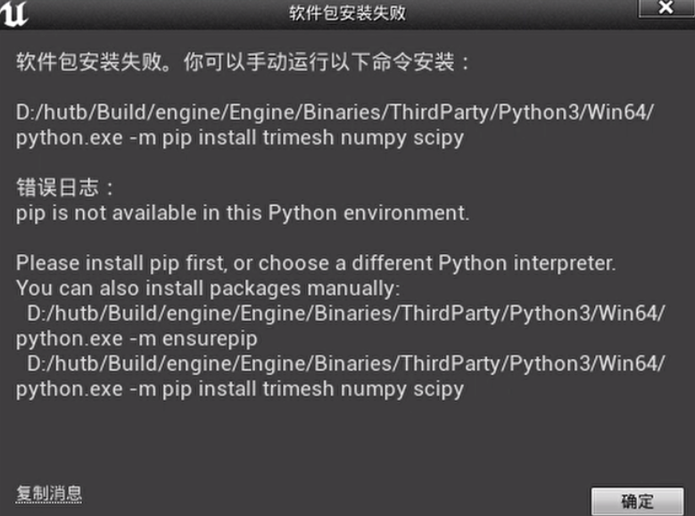

# 导入 MJCF 时 XML 报“未知扩展名 stl”问题分析与解决方案

---

## 1. 现象

把 MuJoCo 的 `*.xml` 从资源管理器拖进内容编辑器后，每个 STL 网格都报：

```text
导入“D:/.../unitree_z1/assets/z1_Link06.stl”失败。未知扩展名“stl”。
```

---

## 2. 结论

总的来说，没有下载`clean_meshes.py`所要用的包，以至于`clean_meshes.py`没有起作用。最终导致的报错。

- 1.`EnsurePythonReady`(MujocoImportFactory.cpp:122)是python编译器以及对应包的准备环节，最主要的就是`if (!InstallPythonPackages(PythonPath, InstallLog))`，（MjPythonHelper.cpp:308）的判断，从而取决于`if (!bPackagesPresent)`对于这个的判断。但是应该是没有包的，应该会下载包，但是通过这张图可以看到安装失败。所以没有安装`clean_meshes.py`所要用的包。
  
- 但是在`clean_meshes.py`为什么这里不报错？
  `clean_meshes.py`没报错是因为错误被吞掉了。由于包trimesh和np只clean_mesh和convert_mesh这个函数里面用并且clean_mesh这个函数只在convert_mesh函数里面用，但是convert_mesh这个函数的报错没有传出去，然后往下走所以网格并没有被清洗所以导致没有将stl转换成obj。最终就会报未知扩展名“stl”。
  `convert_mesh()` 把每个网格的异常都 catch 了（clean_meshes.py:101-103）：

```python
except Exception as e:
    print(f"  x Error: {e}")
    return False
```

调用处（clean_meshes.py:252-255）：

```python
if convert_mesh(actual_source, output_glb):
    success_count += 1
else:
    print(f"  x FAILED to convert {actual_source.name}")
```

失败只打印，不改变进程退出码。随后脚本仍然写出 `_ue.xml`（clean_meshes.py:259），`main()` 里也没有 `sys.exit(1)`（clean_meshes.py:268-282）所以 `ReturnCode == 0` 只代表“脚本没崩”，不代表 GLB 生成成功。

为什么EnsurePythonReady函数被注释了，还会执行到`clean_meshes.py`脚本？

- 2.由于一开始在准备环境的时候，并不会出现弹窗（被注释掉了,所以其中`bOutCancelled`一直都为`false`，PythonPath也走到了最后,中间没有`return FString()`）。所以在调用`EnsurePythonReady`(MujocoImportFactory.cpp:122)函数时从而导致`bOutCancelled`一直都为`false`，导致不会出现 `if (bCancelled)`(MujocoImportFactory.cpp:124)返回空的情况。也就不会在这里报错。然后PythonPath也走到了最后,中间没有`return FString()`。所以PythonPath也存在，就会继续往下执行。

---

## 3. 完整调用链

下面按一次拖入 XML 的实际执行顺序列出调用链（行号以当前 hutb 仓库为准）：

```text
UMujocoImportFactory::FactoryCanImport(Filename)                  // MujocoImportFactory.cpp:60
  └─ UMujocoImportFactory::FactoryCreateFile(...)                 // :66
       ├─ FKismetEditorUtilities::CreateBlueprint(...)            // 创建蓝图
       ├─ FMjPythonHelper::EnsurePythonReady(bCancelled)          // :122 → MjPythonHelper.cpp:179
       │    ├─ ResolvePythonPath()                                // MjPythonHelper.cpp:102
       │    │    ├─ GetStoredPythonOverride()                     // ini 里的 PythonPath
       │    │    ├─ GetUEBundledPythonPath()                      // UE 自带 Python
       │    │    └─ TEXT("python")                                 // PATH 回退
       │    ├─ ValidatePythonBinary(PythonPath)                   // :122
       │    ├─ CheckPythonPackages(PythonPath)                    // :136
       │    │    └─ python -c "import trimesh; import numpy; import scipy"   // :140
       │    └─ InstallPythonPackages(PythonPath, InstallLog)      // :144
       │         └─ python -m pip install trimesh numpy scipy     // :168
       ├─ FPlatformProcess::ExecProcess(PythonExe, Args, ...)     // MujocoImportFactory.cpp:140
       │    └─ clean_meshes.py <model>.xml                        // Scripts/clean_meshes.py
       │         ├─ convert_mesh(actual_source, output_glb)       // clean_meshes.py:64
       │         │    ├─ trimesh.load(...) / clean_mesh(...)      // 解析、清洗
       │         │    ├─ cleaned_mesh.export(...)                 // 导出 GLB
       │         │    └─ except Exception → print + return False  // :101-103  ★ 异常被吞掉
       │         ├─ tree.write(<model>_ue.xml)                    // :259  失败也写
       │         └─ main() 无 sys.exit(1)                          // :268-282 → 退出码 0
       ├─ if (ReturnCode == 0 && _ue.xml 存在)                    // MujocoImportFactory.cpp:142-153
       │    └─ ActualXmlPath = <model>_ue.xml                     // 仍引用 .stl
       └─ Generator->GenerateForBlueprint(NewBP, ActualXmlPath)   // :200
            └─ UMujocoGenerationAction::ParseAssetsRecursive(...) // MujocoXmlParser.cpp:1027
                 ├─ <compiler meshdir="assets">                   // :1044
                 ├─ MeshAssets[name] = .../assets/xxx.stl         // :1101-1106
                 └─ ImportSingleMesh(MeshFile, MeshImportPath)    // :471
                      └─ UMujocoGenerationAction::ImportSingleMesh(...)  // MujocoMeshImporter.cpp:43
                           ├─ BasePath = 去掉扩展名                 // :60
                           ├─ 按 FBX > GLB > GLTF 查同目录           // :60-76
                           │    ├─ 找到 .glb → ActualSourcePath = .glb   // 正常路径
                           │    └─ 都没有 → 保留 .stl               // ★ 本次失败路径
                           └─ AttemptMeshImport(ActualSourcePath, ...)  // :120
                                ├─ Extension == fbx/obj/t3d → Factory = UFbxFactory  // :141
                                └─ 其他（stl）→ Factory = nullptr  // :200
                                     └─ AssetTools.ImportAssetTasks(ImportTasks)  // :216 → AssetTools.cpp:1144
                                          └─ UAssetToolsImpl::ImportAssetsInternal(...)  // AssetTools.cpp:1666
                                               ├─ FactoriesPtr = ExtensionToFactoriesMap.Find("glb")  // :1847
                                               │    └─ 找到 GLTFImportFactory → Factory->ImportObject(...)  // 正常路径
                                               └─ FactoriesPtr = ExtensionToFactoriesMap.Find("stl")  // :1847  
                                                    └─ nullptr → else
                                                         ├─ LOCTEXT("ImportFailed_UnknownExtension", ...)  // :1887
                                                         └─ UE_LOG(LogAssetTools, Warning, "%s")           // :1895
                                                              → 导入“...stl”失败。未知扩展名“stl”。
```

关键点：

- `ReturnCode == 0` 和 `_ue.xml` 存在 **不代表 GLB 生成成功**；`convert_mesh` 的异常会被 `except` 吞掉，脚本仍写 XML、仍退出 0。
- `ImportSingleMesh` 只检查同名 `.glb` **是否存在**，不检查大小/文件头：没有 GLB → 回退 `.stl`；0 字节 GLB → `Invalid GLTF header!`。
- 真正的报错来自引擎 AssetTools（`LogAssetTools`），插件只是因为找不到 GLB，才把 `.stl` 交给它。
- 如果 `EnsurePythonReady` 返回空，会跳过 `ExecProcess`，直接从 `GenerateForBlueprint` 开始走后半段。

---

4.解决方案
在首次将xml文件拖入内容编辑器后让用户做选择，点击“是”就下载对应的包，这样就能够执行`clean_meshes.py`有对应的包。点击“否”就进行选择本地的python编译器，点击取消就会bCancelled=true就直接退出导入（MujocoImportFactory.cpp:124就不会再往下走）。
