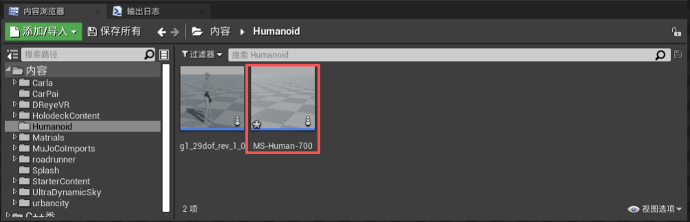
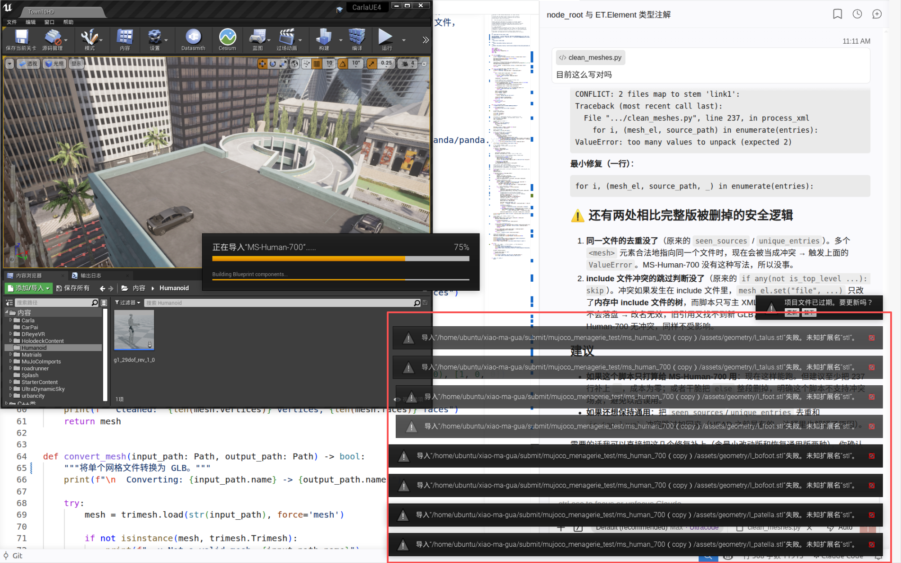

# MS-Human-700.xml 导入失败：日志与解决方案

> 引擎：Unreal Engine 4.26（Linux）　|　插件：UnrealRoboticsLab

> 导入模型：MuJoCo Menagerie `ms_human_700/MS-Human-700.xml`   模型[下载地址](https://github.com/google-deepmind/mujoco_menagerie/tree/main/ms_human_700)

## 总结

`MS-Human-700.xml` 顶层没有任何 `<mesh>`，网格全部再`<include>` 文件里。导入时使用的 `clean_meshes.py` 不会展开 `<include>`，在主 XML 里没有找到**网格**、一个 GLB 都没生成，脚本正常退出并写出了 `_ue.xml`。

## 1. 失败现象

- 把 `MS-Human-700.xml` 拖进内容浏览器，进度条走完后：

  - 蓝图能创建，但模型没有网格（缺少 `Viz_*` StaticMesh 组件）；

  

  - `Saved/Logs/CarlaUE4.log` 中网格出现：

```log
LogURLabEditor: Importing mesh from: .../assets/asset/../geometry/r_pelvis.stl
LogURLabEditor: Using automated factory detection for mesh: .../r_pelvis.stl
LogAssetTools: Warning: 导入".../assets/geometry/r_pelvis.stl"失败。未知扩展名"stl"。
LogURLabEditor: [ImportSingleMesh] Import returned 0 objects:
LogURLabEditor: Warning: Failed to import mesh 'r_pelvis' with MikkTSpace, attempting fallback
LogURLabEditor: Error: Failed to import mesh 'r_pelvis' - all import methods failed
```

如图所示：



## 2. 根因链

### 2.1 MS-Human-700 的网格全部在 include 文件里

```text
MS-Human-700.xml
  <include file="assets/asset/Asset_Lowerbody.xml"/>
  <include file="assets/asset/Asset_Torso.xml"/>
  <include file="assets/asset/Asset_Upperbody.xml"/>
  <include file="assets/asset/Asset_Others.xml"/>

  <include file="assets/contact/Contact_Lowerbody.xml"/>

  <include file="assets/equality/Equality_Lowerbody.xml"/>
  <include file="assets/equality/Equality_Upperbody.xml"/>

  <include file="assets/tendon/Tendon_Leg_r.xml"/>
  <include file="assets/tendon/Tendon_Leg_l.xml"/>
  <include file="assets/tendon/Tendon_Arm_r.xml"/>
  <include file="assets/tendon/Tendon_Arm_l.xml"/>
  <include file="assets/tendon/Tendon_Torso.xml"/>

  <include file="assets/muscle/Muscle_Leg_r.xml"/>
  <include file="assets/muscle/Muscle_Leg_l.xml"/>
  <include file="assets/muscle/Muscle_Arm_r.xml"/>
  <include file="assets/muscle/Muscle_Arm_l.xml"/>
  <include file="assets/muscle/Muscle_Torso.xml"/>
```

### 2.2 旧版 `clean_meshes.py` 不展开 `<include>`

旧实现只扫主树的内容：

```python
mesh_elements = list(root.iter("mesh"))
```

**关键点：脚本即使一个网格都没转换，也会正常退出并写出 `_ue.xml`。**

## 3. 解决方案

### 使用支持 include 递归展开的 `clean_meshes.py`

脚本位置：`/hutb/Unreal/CarlaUE4/Plugins/UnrealRoboticsLab/Scripts/clean_meshes.py`

核心逻辑是新增递归收集函数 `collect_from_include`：

```python
# 递归函数：从给定节点收集网格和 <include>，并解析包含的文件
    def collect_from_include(node_root: ET.Element, owner_dir: Path):
        base_dir = mesh_base if meshdir else owner_dir

        for mesh_el in node_root.iter("mesh"):
            file_attr = mesh_el.get("file")
            if not file_attr:
                continue

            # 确保显式名称属性存在——如果省略，MuJoCo 默认使用文件名前缀。
            # 在更改文件属性之前，我们必须保留它。
            if mesh_el.get("name") is None:
                implicit_name = Path(file_attr).stem
                mesh_el.set("name", implicit_name)
                print(f"  Set explicit name='{implicit_name}' on mesh with file='{file_attr}'")

            # 添加网格条目：包括 mesh 元素和源文件路径
            mesh_elements.append((mesh_el, base_dir / file_attr))

        for include_el in node_root.iter("include"):
            file_attr = include_el.get("file")
            if not file_attr:
                continue
            # resolve() 是 pathlib.Path 的方法：把路径规范化成唯一的绝对路径。
            # 它做三件事：
            # 1.变成绝对路径（相对路径拼上当前工作目录）
            # 2.消掉 . 和 ..（纯字符串/路径层面的规整）
            # 3.解析符号链接（symlink 指向哪，就得到真实路径）
            include_path = (owner_dir / file_attr).resolve()
            if include_path in seen_includes:
                continue
            seen_includes.add(include_path)
            if not include_path.exists():
                print(f"  x Included file not found: {include_path}")
                continue
            print(f"  Expanding include: {include_path}")
            try:
                # 得到include的文件中的根节点
                include_root = ET.parse(str(include_path)).getroot()
            except ET.ParseError as e:
                print(f"  x Failed to parse {include_path}: {e}")
                continue
            # 再看include文件中的 <include>，递归展开
            collect_from_include(include_root, include_path.parent)

    collect_from_include(root, xml_dir)
```
