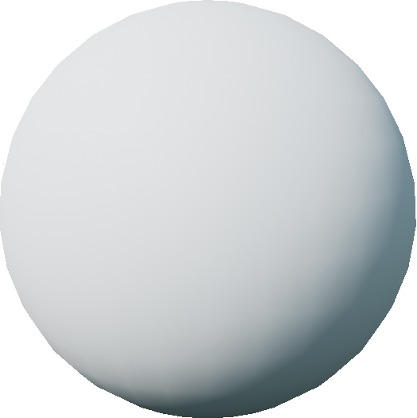
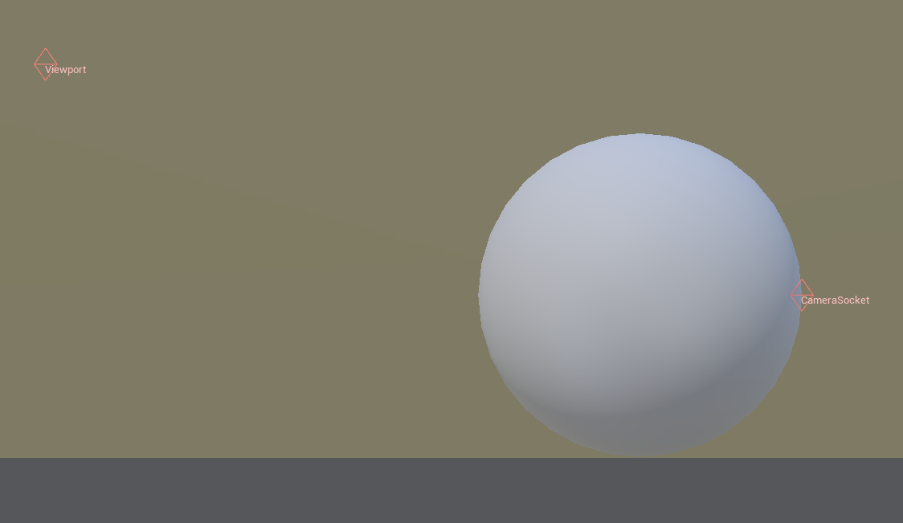

# 球形代理 (SphereAgent)

## 描述

这是一个在平面上移动的简单球形机器人。SphereAgent 没有物理特性——它只是计算出下一个位置并直接瞬移过去，这与具有质量和动量的其他代理（例如[海龟代理](./turtle_agent.md)）不同。

更多详情请参阅 [SphereAgent](https://byu-holoocean.github.io/holoocean-docs/v2.4.0/holoocean/agents.html#holoocean.agents.SphereAgent)。

## 控制方案

* 球体离散控制 (`0`)

    一个长度为 1 的整数向量，可取以下四个值之一：0：前进，1：后退，2：右转，3：左转。

* 球体连续控制 (`1`)

    一个长度为 2 的浮点向量，用于指定代理的前进速度（索引 0）和旋转速度（索引 1）。

## 接口（Socket）

除非另有说明，所有接口均以代理本体坐标系（右手NWU坐标系，x轴指向前方，y轴指向左侧，z轴指向上方）为基准。详情请参阅[传感器放置与接口](../sensors/sensor_config.md#sockets)部分。

* `CameraSocket`（位于球体前方）

* `Viewport`（位于代理后方）

