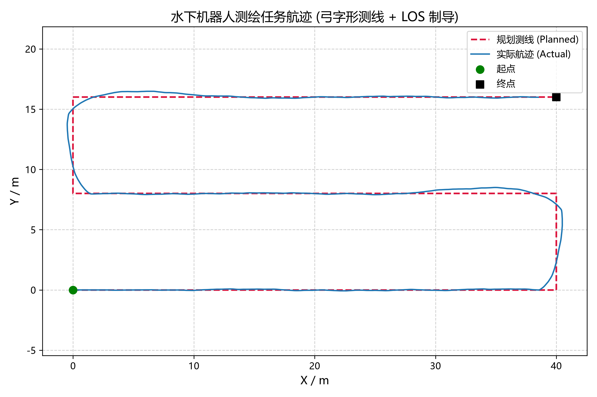
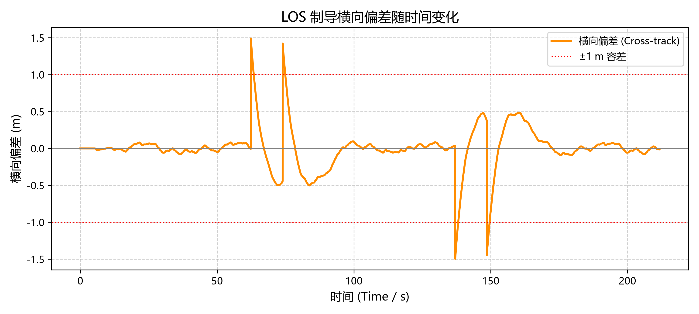
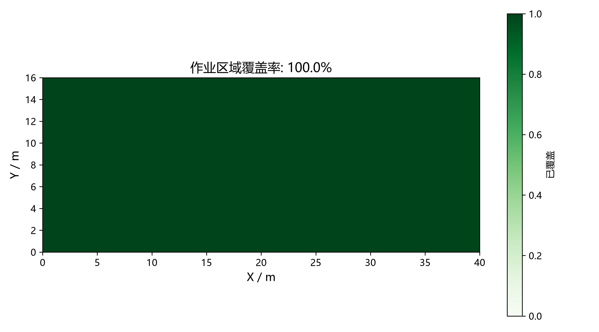

# 水下机器人测绘任务仿真

基于 MuJoCo 的水下测绘任务层，实现 **弓字形测线规划 → LOS 制导 → PI 速度/艏向控制 + 深度 PID → 覆盖率评估** 的完整闭环，可脱离 Unreal 引擎单独运行。

与已有的 `underwater_sim.py`（基础流体/浮力/阻力/PID 悬浮）互补：那个脚本回答“ROV 在流体里怎么动”，本示例回答“ROV 怎么把一个作业区域扫完”。

## 功能组成

| 模块 | 文件 | 说明 |
| --- | --- | --- |
| 路径规划 | `src/underwater/survey_mission.py` | 弓字形（lawnmower）测线生成，支持任意朝向与起点 |
| 制导 | 同上，`LOSGuidance` | 视线法（Line-Of-Sight）跟踪，输出期望艏向与横向偏差 |
| 覆盖评估 | 同上，`CoverageTracker` | 栅格化统计声呐扫幅对作业区域的覆盖比例 |
| 任务指标 | 同上，`evaluate_mission` | 横向偏差 RMS/峰值、航程、耗时、覆盖率 |
| 仿真 | `src/underwater/survey_mission_sim.py` | MuJoCo 闭环仿真、控制律、数据记录与绘图 |
| 单元测试 | `src/underwater/tests/test_survey_mission.py` | 纯数学部分测试（不依赖 MuJoCo） |

## 原理

### 1. 覆盖路径规划

测线沿作业区域局部 X 方向往返，相邻测线沿 Y 方向等距排布：

$$
n = \left\lceil \frac{H}{s} \right\rceil , \qquad \Delta y = \frac{H}{n} \le s
$$

其中 $H$ 为区域宽度、$s$ 为期望测线间距。取整后再均分，保证实际间距不超过设定值，且最后一条测线正好落在边界上。

路径点会随规划整体旋转 `heading` 并平移到 `origin`，因此可以直接把作业区摆到世界坐标的任意位置。

### 2. LOS 制导

把当前位置 $P$ 投影到当前测线段 $\overline{AB}$ 上得到垂足 $F$，横向偏差定义为叉积：

$$
e_{ct} = \hat{u} \times (P - A) , \qquad \hat{u} = \frac{B - A}{\lVert B - A \rVert}
$$

路径左侧为正、右侧为负。前视点取 $T = F + L \cdot \hat{u}$（且不越过 $B$），期望艏向为

$$
\psi_d = \operatorname{atan2}(T_y - P_y,\; T_x - P_x)
$$

当存在横向偏差时，前视方向自然指向测线，形成回中趋势；前视距离 $L$ 越大越平缓、越小越激进。

### 3. 控制律

* **水平速度环（PI）**：把期望速度 $v_d = u_{cruise}\,[\cos\psi_d, \sin\psi_d]$ 与实际世界系速度做差，输出世界系推力，再投影到机体系限幅（模拟推进器能力上限）后转回世界系：

$$
F = K_p (v_d - v) + K_i \int (v_d - v)\,dt , \qquad \lVert F \rVert \le F_{max}
$$

  积分项用于抵消 MuJoCo 椭球流体模型带来的二次阻力（纯 P 控制会留下明显的稳态速度误差）。

* **艏向环（PD）**：$\tau_z = K_{p\psi}\, e_\psi - K_{d\psi}\, \dot{\psi}$，力矩限幅 $|\tau_z| \le \tau_{max}$。

* **深度环**：复用 `depth_controller.PIDDepthController`，叠加静态浮力 $F_b = \rho g V$ 前馈。

### 4. 覆盖率

作业区域被离散成 `grid_resolution` 见方的栅格，ROV 每走过一段航迹，就把以航迹点为圆心、直径 `swath_width`（声呐扫幅）的圆内栅格标记为已覆盖，段内按半格插值避免漏格。

工程上测线间距应略小于扫幅（即保留 10%–25% 的**重叠率**），否则跟踪误差会在测线交界处留下未覆盖的条带。

## 运行

```bash
cd src/underwater
pip install mujoco numpy matplotlib

# 无界面运行（保存航迹 CSV 与结果图）
python survey_mission_sim.py

# 同时打开 MuJoCo Viewer 观察
python survey_mission_sim.py --viewer
```

输出：

* `docs/img/underwater/survey_trajectory.png` —— 规划测线 vs 实际航迹
* `docs/img/underwater/survey_cross_track.png` —— 横向偏差曲线
* `docs/img/underwater/survey_coverage.png` —— 覆盖率栅格图
* `docs/img/underwater/survey_track.csv` —— 时间、位置、速度、横向偏差

## 实测结果

默认配置（40 m × 16 m 作业区、测线间距 8 m、航速 1.0 m/s、目标深度 −5 m）：

| 指标 | 数值 |
| --- | --- |
| 覆盖率 | **100.0 %** |
| 横向偏差 RMS | **0.276 m** |
| 横向偏差峰值 | 1.496 m（出现在测线末端的 180° 掉头处） |
| 实际航程 / 规划航程 | 131.9 m / 136.0 m |
| 任务耗时 | 211.7 s |
| 是否完成 | 是 |



掉头时因为要同时完成减速转向，横向偏差会短时冲到 1.5 m 左右；直线段上偏差稳定在 ±0.2 m 内。





## 配置项

`src/underwater/data/config.json` 中的 `survey_mission` 段：

| 字段 | 含义 |
| --- | --- |
| `area_width` / `area_height` | 作业区域尺寸 (m) |
| `lane_spacing` | 期望测线间距 (m) |
| `origin` / `heading` | 作业区域位置与朝向 |
| `target_depth` | 测绘深度 (m，负值) |
| `cruise_speed` | 巡航速度 (m/s) |
| `lookahead` | LOS 前视距离 (m) |
| `accept_radius` | 路径点切换半径 (m) |
| `timeout_seconds` | 仿真超时 (s) |
| `swath_width` | 声呐扫幅 (m)，建议取 `lane_spacing × 1.1 ~ 1.25` |
| `grid_resolution` | 覆盖率栅格边长 (m) |
| `controller.*` | 速度环 / 艏向环增益与限幅 |

## 单元测试

```bash
cd src/underwater
python -m pytest tests/ -v
```

覆盖测线生成（边界、间距、蛇形交替、旋转平移、非法输入）、LOS 制导（偏差符号、回中趋势、航点切换）、覆盖率统计与指标汇总，共 14 个用例。
