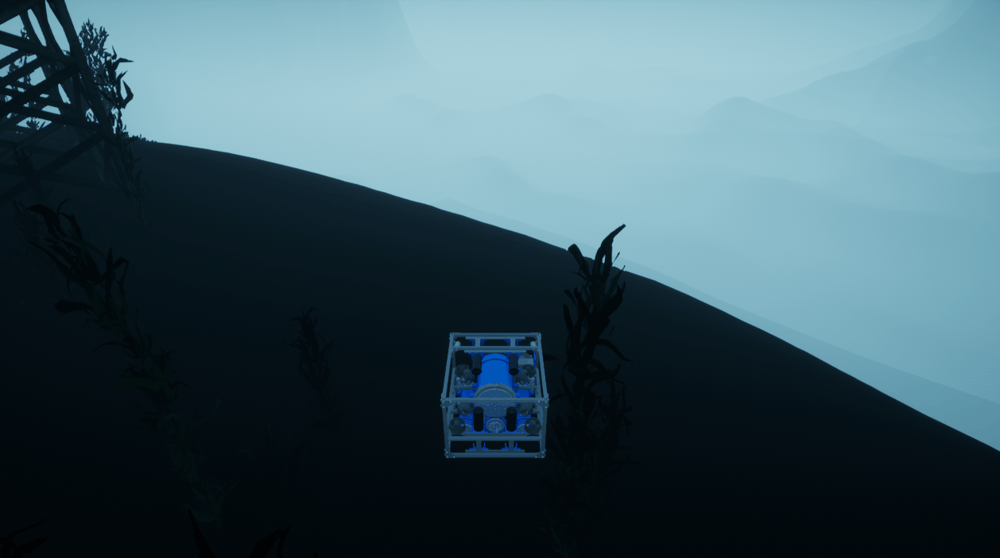

# 入门与示例

## 运行前准备

建议先安装以下 Python 依赖，其中 `posix_ipc` 用于与仿真世界进程共享内存，
缺失时会在 `holoocean.make()` 处报 `ModuleNotFoundError: No module named 'posix_ipc'`：

```bash
pip install posix_ipc psutil lcm numpy
```

### 世界包版本需与 holoocean 包版本一致

HoloOcean 会到 `~/.local/share/holoocean/<版本号>/worlds/` 下查找场景文件，
其中 `<版本号>` 取自 `holoocean.__version__`。若已下载的世界包版本与它不一致
（例如包为 `1.0.0`、世界包解压在 `2.3.0` 目录），运行时会报：

```
FileNotFoundError: The file `XXX.json` could not be found in
~/.local/share/holoocean/1.0.0
```

确认版本：

```bash
python -c "import holoocean; print(holoocean.__version__)"
ls ~/.local/share/holoocean/
```

若不一致，可建立软链接快速验证：

```bash
ln -s ~/.local/share/holoocean/2.3.0 ~/.local/share/holoocean/1.0.0
```

### 示例脚本不要在与其同名的目录下运行

`PythonAPI/examples/holoocean.py` 与 Python 包同名，若在该目录下执行
`import holoocean`，会导入脚本自身并触发循环导入错误。请在其它目录运行，
或使用绝对路径加载脚本。

### 关于画面提示

Development 版世界包未烘焙光照，启动时可能出现
`LIGHTING NEEDS TO BE REBUILT` 提示，不影响功能。

首先，请参阅安装以安装 holocean 包和 Ocean。

HoloOcean的最小使用示例（[getting_started.py](https://github.com/OpenHUTB/mujoco_plugin/blob/main/src/underwater/holo_ocean/getting_started.py)）如下：

```python
import holoocean
import numpy as np

env = holoocean.make("PierHarbor-Hovering")

# 悬停的AUV对每个推进器发出指令
command = np.array([10,10,10,10,0,0,0,0])

for _ in range(1800):
   state = env.step(command)
```


请注意：

1. 您将场景的名称传递给 holoocean.make

   请参阅可用的所有不同世界和场景的软件包。

2. HoloOcean 的界面旨在让 OpenAI Gym 熟悉

您可以使用状态字典访问特定传感器的数据：

```python
dvl = state["DVLSensor"]
```

**就是这样！**HoloOcean的使用相当简单。

查看可用的不同[世界](./packages/packages.md#all_packages)，阅读[API文档](https://byu-holoocean.github.io/holoocean-docs/UE4.27_archival_develop/holoocean/index.html#holoocean-api-index)，或者开始制作自己的自定义[场景](./usage/scenarios.md#scenarios)。


[这里](./example/examples.md)是一些片段，展示了如何使用 HoloOcean 的不同方面。


