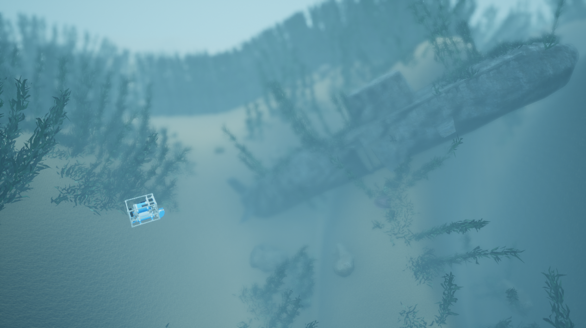

# 开放水域悬停成像声呐（OpenWater-HoveringImagingSonar）

此场景开始时，一艘悬停式自主水下航行器 (HoveringAUV) 位于潜艇附近。此场景与基础版本相同，只是加装了摄像头。除非另有说明，所有传感器均与其类名相同，例如 IMUSensor 被命名为“IMUSensor”。

* auv0：主[悬停式自主水下航行器](https://byu-holoocean.github.io/holoocean-docs/UE4.27_archival_develop/agents/hovering-auv-agent.html#hovering-auv-agent)代理

    * [IMUSensor](https://byu-holoocean.github.io/holoocean-docs/UE4.27_archival_develop/holoocean/sensors.html#holoocean.sensors.IMUSensor) 配置了噪声和偏差，并返回偏差值。

    * [GPSSensor](https://byu-holoocean.github.io/holoocean-docs/UE4.27_archival_develop/holoocean/sensors.html#holoocean.sensors.GPSSensor) 获取表面 N(1, 0.25) 范围内的测量值，实际测量值也包含噪声。

    * [DVLSensor](https://byu-holoocean.github.io/holoocean-docs/UE4.27_archival_develop/holoocean/sensors.html#holoocean.sensors.DVLSensor) 配置了 22.5 度仰角和噪声，并返回 4 个距离测量值。

    * [ImagingSonar](https://byu-holoocean.github.io/holoocean-docs/UE4.27_archival_develop/holoocean/sensors.html#holoocean.sensors.ImagingSonar) 配置为仰角 20 度，方位角 130，范围 1-40 米，初始八叉树生成 40 米，所有噪声均已开启。

    * [DepthSensor](https://byu-holoocean.github.io/holoocean-docs/UE4.27_archival_develop/holoocean/sensors.html#holoocean.sensors.DepthSensor) 配置了噪声。

    * [PoseSensor](https://byu-holoocean.github.io/holoocean-docs/UE4.27_archival_develop/holoocean/sensors.html#holoocean.sensors.PoseSensor) 用于获取真实值。

    * [VelocitySensor](https://byu-holoocean.github.io/holoocean-docs/UE4.27_archival_develop/holoocean/sensors.html#holoocean.sensors.VelocitySensor) 用于获取真实值。
    
!!! 注意                                 
    本场景带有 `ImagingSonar`，首次加载需要生成八叉树，启动明显慢于普通场景：实测约 **35 秒**。 期间窗口可能短暂显示「未响应」，属正常现象，请耐心等待，不要中断进程。

