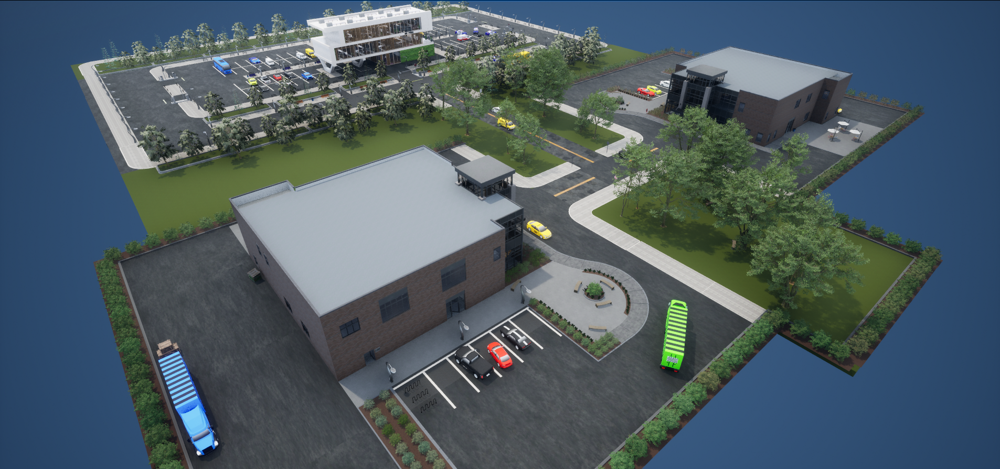
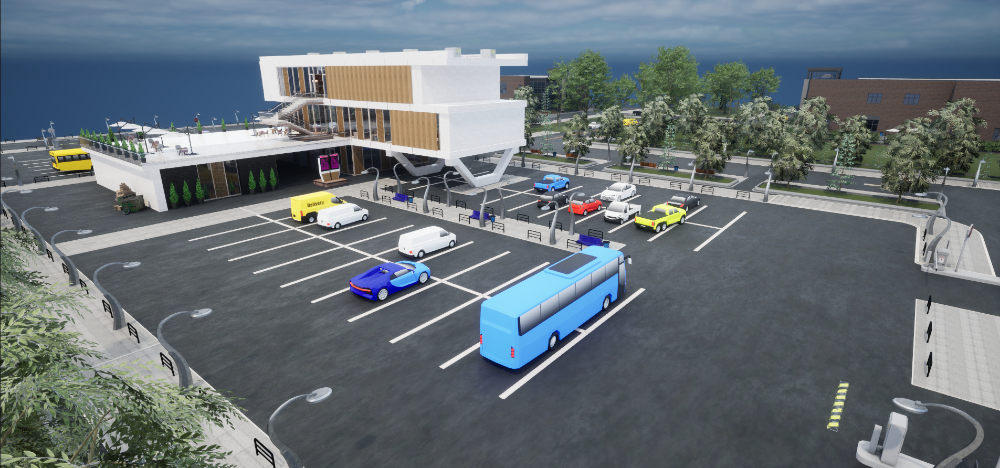
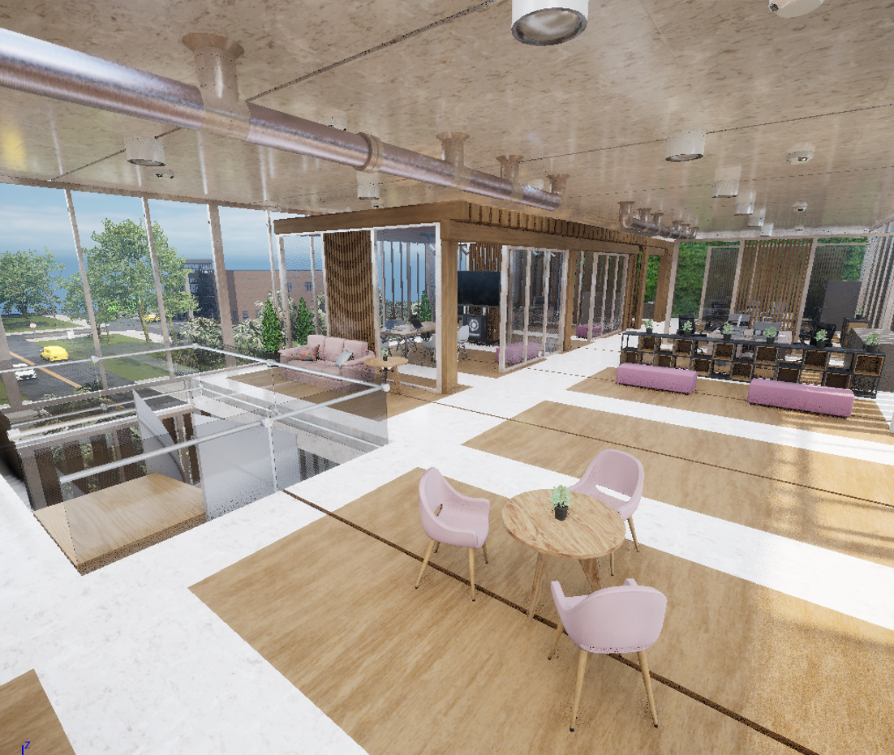
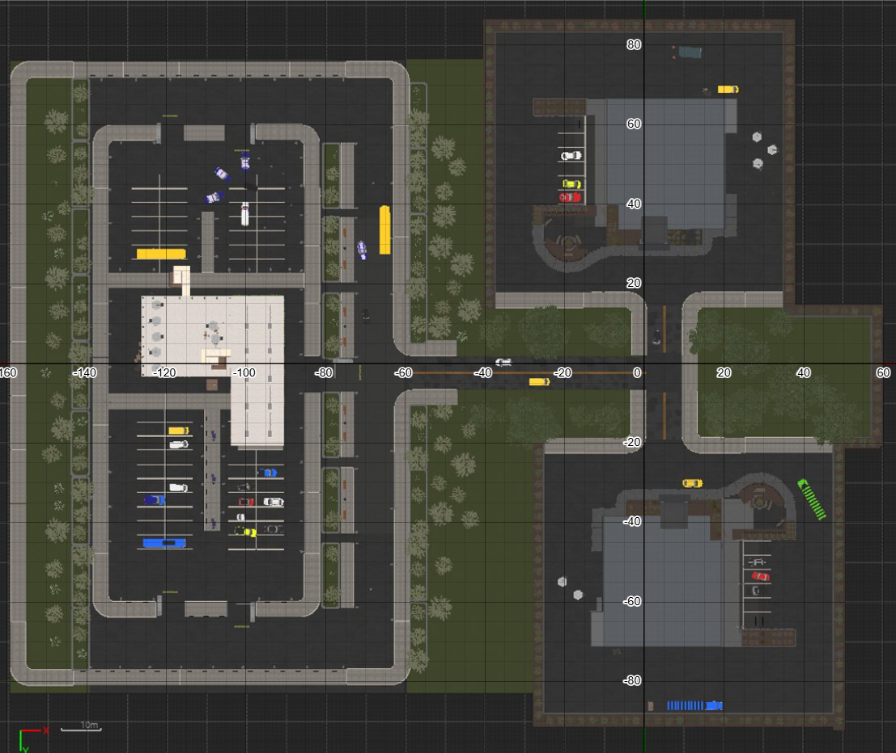
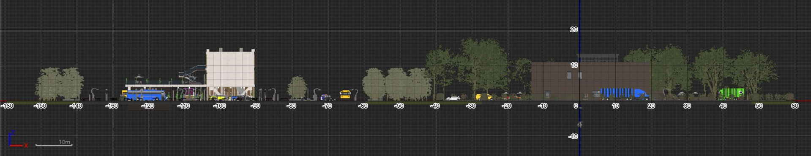

# 商业园区（BusinessCampus）

商业园区环境的面积约为 200 米 x 200 米，其中有 3 栋建筑，所有建筑的内部都可以进入查看。关卡中的物体都带有语义标签，可以配合[语义分割相机](../sensors/semantic_segmentation_camera_sensor.md)和[Raycast 语义激光雷达传感器](../sensors/raycast_semantic_lidar_sensor.md)使用。

HoloOcean 中的坐标与虚幻引擎编辑器中显示的坐标不同。下面两张图标注了商业园区关卡在 HoloOcean 中的坐标。

## 语义标签 

该关卡使用以下语义标签（完整的标签列表见[添加自定义语义标签](../sensors/custom_semantics.md#semantic_labels)）：

| 文件夹名字  | 模板值 | RGB 值 |
|-------|--------|-------|
| None（无）     | 0  | {0, 0, 0}  |
| Landscape（景色）     | 4  | {153, 153, 153}  |
| Trash（垃圾）     | 24  | {107, 156, 137}  |
| Grass（草）     | 25  | {91, 235, 52}  |
| Asphalt（沥青）     | 26  | {79, 82, 77}  |
| Bench（长凳）     | 27  | {212, 191, 125}  |
| BikeRack（自行车架）     | 28  | {209, 208, 203}  |
| Building（建筑物）     | 29  | {31, 240, 205}  |
| Bus（公共汽车）     | 30  | {240, 220, 43}  |
| Bush（灌木）     | 31  | {177, 247, 124}  |
| Car（汽车）     | 32  | {224, 109, 237}  |
| Ceiling（天花板）     | 33  | {161, 247, 233}  |
| Chair（椅子）     | 34  | {65, 13, 255}  |
| Cone（圆锥体）     | 35  | {255, 169, 10}  |
| Crate（板条箱）     | 36  | {140, 86, 0}  |
| Desk（书桌）     | 37  | {242, 65, 224}  |
| Dumpster（大垃圾桶）     | 38  | {0, 138, 14}  |
| FireHydrant（消防栓）     | 39  | {255, 0, 0}  |
| Floor（地板）     | 40  | {2, 125, 104}  |
| GarbageCan（垃圾桶）     | 41  | {0, 184, 92}  |
| Pallet（托盘）     | 42  | {143, 129, 6}  |
| ParkingGate（停车门）     | 43  | {222, 164, 177}  |
| PatioUmbrella（庭院遮阳伞）     | 44  | {195, 0, 255}  |
| Railing（栏杆）     | 45  | {242, 97, 130}  |
| SemiTruck（半挂式卡车）     | 46  | {124, 6, 138}  |
| Sidewalk（人行道）     | 47  | {232, 232, 232}  |
| SpeedLimitSign（限速标志）     | 48  | {222, 218, 245}  |
| StopSign（停车标志）     | 49  | {250, 37, 62}  |
| StreetLamps（路灯）     | 50  | {255, 149, 10}  |
| Table（桌子）     | 51  | {186, 17, 169}  |
| Tree（树）     | 52  | {69, 99, 46}  |
| Wall（墙）     | 53  | {126, 60, 250}  |
| Unlabeled（未贴标签）     | 54  | {0, 0, 0}  |
| Any（任何一个）     | 255  | {255, 255, 255}  |
